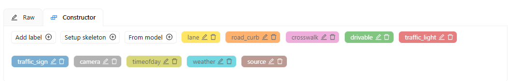
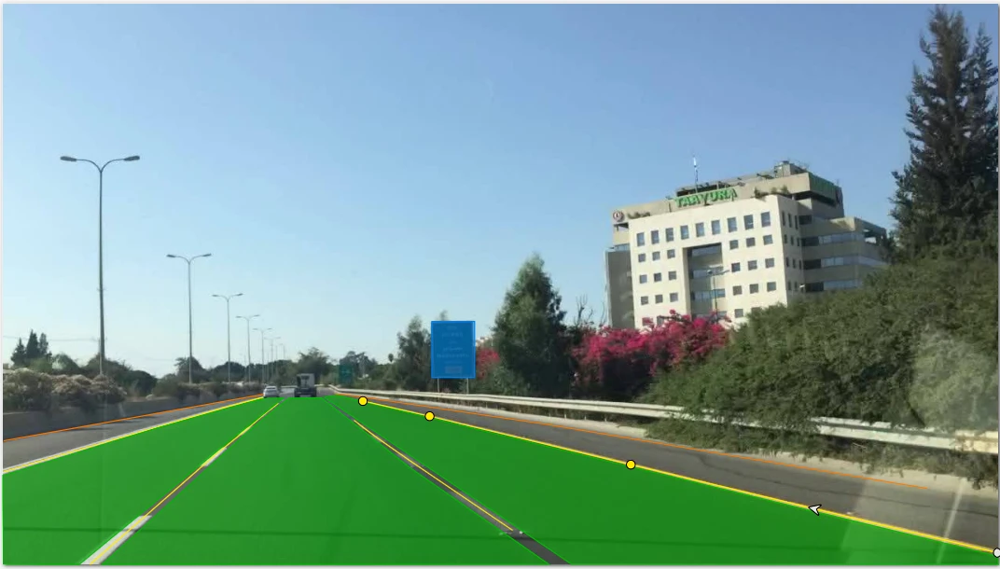
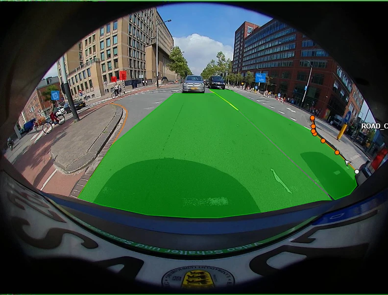
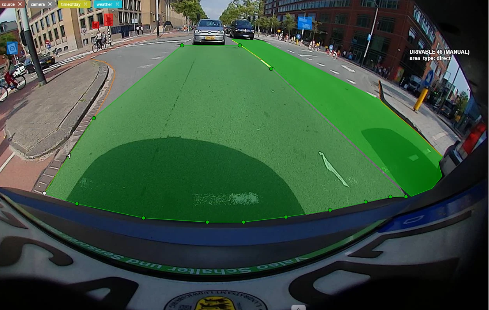

# Báo cáo cá nhân — Ngày 11
Họ tên: Đỗ Hoàng Anh    Mã học viên: 2A202603187
Phiên bản CVAT (Help → About): 2.81.0
Guideline: Road v1.0    Lần nộp (`revision` trong manifest): 4
Thời điểm export : 21/11/2026, front 10:30 và fisheye 10:21    Số lần nộp lại sau Rework: 0 

## 1. Kiểm project
| Mục | Đúng như guideline Road v1.0? | Ghi chú |
| --- | --- | --- |
| 6 label, đúng kiểu | Đúng | lane và road_curb là polyline, crosswalk và drivable là polygon, traffic_light và traffic_sign là rectangle |
| Thuộc tính và giá trị | Đúng | Dán JSON từ `road_lab.taxonomy` vào tab Raw, nên khớp từng giá trị |
| 4 tag ảnh | Đúng | camera, timeofday, weather, source; mỗi tag có một thuộc tính select `value` |


## 2. Số lượng đã gán
| Task | Ảnh | lane | road_curb | crosswalk | drivable | traffic_light | traffic_sign |
| --- | ---: | ---: | ---: | ---: | ---: | ---: | ---: |
| front | 12 | 29 | 10 | 5 | 23 | 26 | 26 |
| front-extra (đã làm 0 / 4) | 0 | 0 | 0 | 0 | 0 | 0 | 0 |
| fisheye | 8 | 6 | 11 | 7 | 11 | 4 | 2 |
| fisheye-extra (đã làm 0 / 4) | 0 | 0 | 0 | 0 | 0 | 0 | 0 |


## 3. Bảng ca khó
| Ảnh | Nhãn | Phân vân giữa | Đã chọn | Lý do |
| --- | --- | --- | --- | --- |
| A05 | lane L1, R1 | Vẽ hay bỏ | Bỏ | Đường nhỏ, hai bên đỗ xe, mặt đường không có vạch sơn nào |
| A06 | lane R1 | Vẽ hay bỏ | Bỏ | Đường rộng dưới cầu vượt, bên phải xe không có vạch phân làn. Chỉ có một vạch trắng ở góc dưới phải, quá xa xe để gán R1 |
| A09 | lane R1 | Vẽ hay bỏ | Bỏ | Bên phải chỉ có lề đường, không có vạch |
| A04, A09, A11 | lane (vạch đôi) | Một polyline `kind=double` hay hai polyline | Hai polyline, mỗi nét một polyline, cùng `kind=double` | Guideline chỉ ghi "hai nét song song thì chọn `kind=double`", không nói số polyline. Tôi vẽ theo từng nét sơn nhìn thấy. Lint và bạn kiểm đều báo QC1-05, nên tôi để ghi nhận là ca chờ coach |

## 4. Phiếu QC 1 nhận được
Bạn kiểm lô của tôi: letienbinh   Quyết định nhận được: Rework (3 lỗi nặng, lỗi chính 9/76 nhãn = 11,8 %)
| Mã lỗi | Số lỗi | Đồng ý? | Đã sửa? |
| --- | ---: | --- | --- |
| QC1-08 đèn, màu (nặng) | 3 | Đồng ý cả 3. Tôi cắt ảnh phóng to: đèn A03 và A04 đang sáng xanh nhưng tôi gán yellow. Đèn B02 là đèn người đi bộ đang xanh, tôi gán unknown và type vehicle | Rồi (A03, A04 đổi thành green; B02 đổi thành green và pedestrian) |
| QC1-07 vùng lái | 4 | Đồng ý 3 (A04 và A05 chỉ có alternative, không có direct; A03 polygon bên phải gồm dải đỗ xe). Chưa chắc 1 (A05 tràn vào dải đỗ xe): đường polygon đi sát chân hàng xe đỗ, tôi hỏi lead | Một phần: A04 và A05 đã đổi sang direct. Polygon alternative ở A03 chưa thu khỏi dải đỗ xe, và A05 chờ lead |
| QC1-10 đủ biển | 2 | Đồng ý cả 2: thiếu biển trường học ở A03 và biển phụ "PASSENGER CARS ONLY" ở A08 | Rồi (A03 thêm biển trường học với group warning; A08 thêm biển phụ supplementary) |
| QC1-11 fisheye | 2 | Đồng ý: hai đèn B02 sát rìa vòng ảnh, chưa bật edge_zone | Rồi, đã bật edge_zone cho cả hai đèn |
| QC1-05 vạch đứt | 1 | Đồng ý: vạch vàng đôi ở A04 tôi vẽ thành 2 polyline. A09 và A11 cũng bị như vậy | Chưa, A04, A09, A11 vẫn là 2 polyline |
| QC1-12 file | 10 | Đồng ý: điểm lặp liền nhau do click hai lần | Chưa |

Ghi chú thêm của bạn kiểm cho ngoài 6 ảnh mẫu: A07 `weather = overcast` nhưng đường ướt, nên là `rain` (đúng, đã sửa); B08 `lane#4` thiếu điểm theo cung (đúng, chưa sửa). Bạn kiểm cũng hỏi coach xác nhận QC1-02 ở A05 là ca không thấy vạch.

## 5. Kiểm file export
| File | Mở lại được? | Số shape ảnh 1 (job / file) | Số shape ảnh 2 (job / file) | Tag camera có trong XML? |
| --- | --- | --- | --- | --- |
| dohoanganh-front.zip | Được | A01: / 10 | A02: / 8 | Có |
| dohoanganh-fisheye.zip | Được | B01: / 4 | B02: / 5 | Có |


## 6. Ảnh chụp màn hình
1. Tab Labels của project: đủ 6 label vẽ và 4 label tag.



2. Một ảnh camera trước đã gán: vùng lái, vạch làn, mép đường và biển.



3. Ảnh fisheye B03 (camera sau) đã gán: vùng lái dừng ở mép thân xe, polyline mép đường đi theo cung ở bên phải.



Phóng to vùng lái của B03: các điểm đặt dày dọc cung dưới theo mép thân xe, bốn tag ảnh ở góc trên trái.



4. Một đoạn XML có `<polyline label="lane">` (ảnh A01, trong `dohoanganh-front.zip`):

```xml
<polyline label="lane" source="manual" occluded="0" points="111.85,720.00;273.16,578.75;311.77,547.57;334.56,527.88;345.35,519.37;353.44,513.18" z_order="0">
  <attribute name="position">L1</attribute>
  <attribute name="style">dashed</attribute>
  <attribute name="color">white</attribute>
  <attribute name="kind">single</attribute>
</polyline>
```

## 7. Tự đánh giá
Lỗi tôi mắc nhiều nhất là QC1-02, thiếu L1 hoặc R1: lần lint đầu tiên có 12 ảnh dính lỗi này. Kế đến là QC1-01, quên đặt tag ở A06, A07, A14 và B06, và quên đổi `camera` từ front sang fisheye_front ở B01. Nguyên nhân là tôi vẽ nhãn trước rồi để tag cho sau, và CVAT tự điền giá trị mặc định nên nhìn tưởng đã xong. Ở Ngày 20 tôi sẽ đặt bốn tag ngay khi mở ảnh, và đọc lại từng tag trước khi sang ảnh khác. 

Nhãn của tôi đi vào model huấn luyện nhận diện làn đường. Một lỗi tôi đã sửa là A09: vạch trắng đứt ở bên trái xe nhưng tôi gán R1. Nếu để nguyên, model sẽ học rằng vạch nằm bên trái ảnh có nhãn "bên phải". Model dùng để giữ làn sẽ hiểu sai xe đang nằm ở đâu trong làn, kéo xe về sai hướng, và lỗi này khó thấy vì hình vẽ vẫn đúng chỗ, chỉ có nhãn `position` sai.
